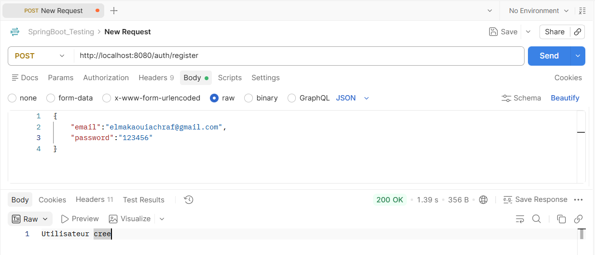
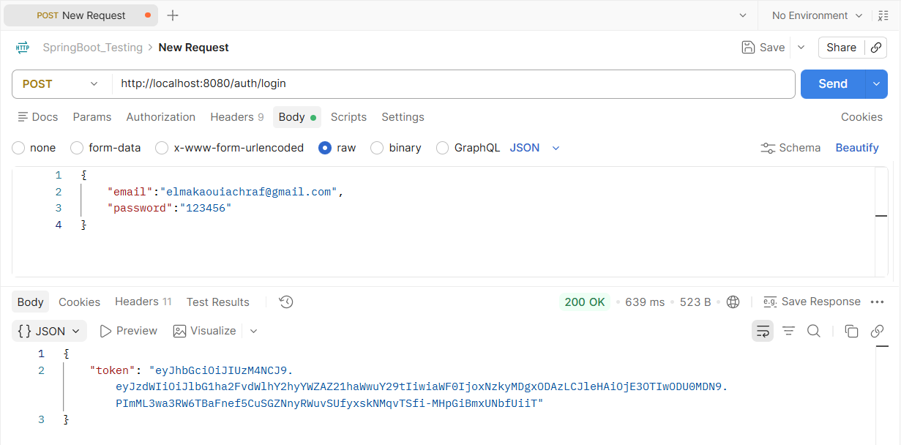
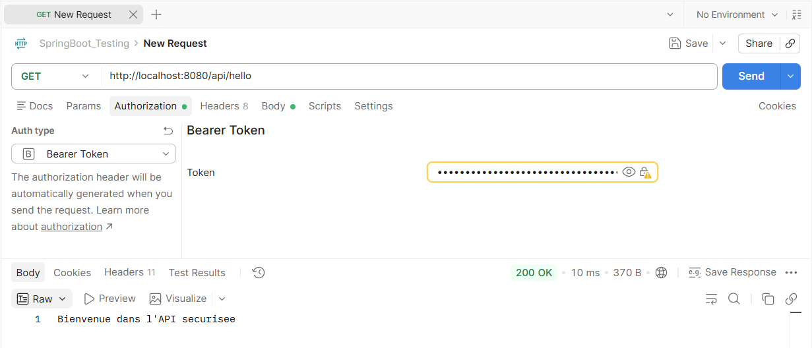
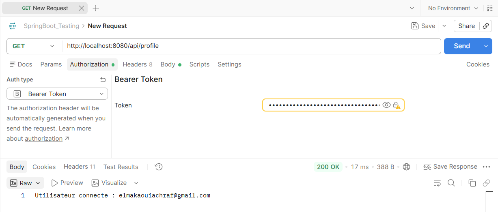

# TP : Authentification JWT avec Spring Boot et Spring Security

Ce projet implémente une API REST sécurisée avec **Spring Boot**, **Spring Security** et **JWT (JSON Web Token)** permettant l'inscription, l'authentification des utilisateurs et l'accès à des ressources protégées.

---

## Technologies utilisées
* **Java / Spring Boot**
* **Spring Security**
* **Spring Data JPA & H2 Database**
* **JJWT (`0.13.0`)** 
* **Postman**

---

## Structure du projet

```text
com.elmakaoui.jtp_jwt
├── config
│   └── SecurityConfig.java           
├── controller
│   ├── AuthController.java           
│   └── UserController.java           
├── dto
│   ├── AuthResponse.java             
│   ├── LoginRequest.java             
│   └── RegisterRequest.java          
├── entity
│   └── AppUser.java                  
├── repository
│   └── UserRepository.java           
├── security
│   ├── JwtFilter.java                 
│   └── JwtService.java               
├── service
│   └── CustomUserDetailsService.java  
└── TpJwtApplication.java           
```

---

## Configuration (`application.properties`)

```properties
spring.application.name=tp_jwt
spring.datasource.url=jdbc:h2:mem:securitydb
spring.datasource.driverClassName=org.h2.Driver
spring.datasource.username=sa
spring.datasource.password=
spring.jpa.hibernate.ddl-auto=update
spring.jpa.show-sql=true
spring.h2.console.enabled=true
spring.h2.console.path=/h2-console
jwt.secret=(jwt secret chaîne de caractères encodée en Base64)
jwt.expiration=3600000
```

---

## Endpoints de l'API

| Méthode | Endpoint | Accès | Description |
| :--- | :--- | :--- | :--- |
| `POST` | `/auth/register` | Public | Création d'un nouveau compte utilisateur |
| `POST` | `/auth/login` | Public | Authentification et génération du token JWT |
| `GET` | `/api/hello` | Authentifié (JWT) | Message de bienvenue dans l'API sécurisée |
| `GET` | `/api/profile` | Authentifié (JWT) | Retourne l'email de l'utilisateur connecté |

---

## Tests et Résultats (Postman)

### 1. Inscription d'un nouvel utilisateur (`POST /auth/register`)
Envoi des identifiants (`email` et `password`) pour créer un nouvel utilisateur en base de données avec le mot de passe haché via `BCryptPasswordEncoder`.
* **Statut :** `200 OK`
* **Réponse :** `Utilisateur cree`



---

### 2. Authentification et génération du Token (`POST /auth/login`)
Vérification des identifiants via `AuthenticationManager` et génération d'un token JWT signé en cas de succès.
* **Statut :** `200 OK`
* **Réponse :** Objet JSON contenant le `token` JWT.



---

### 3. Accès au endpoint sécurisé `/api/hello` (`GET /api/hello`)
Envoi d'une requête `GET` en incluant le token JWT récupéré dans l'en-tête `Authorization: Bearer <token>`.
* **Statut :** `200 OK`
* **Réponse :** `Bienvenue dans l'API securisee`



---

### 4. Consultation du profil utilisateur (`GET /api/profile`)
Vérification de l'identité extraite du contexte de sécurité à partir du token JWT valide.
* **Statut :** `200 OK`
* **Réponse :** `Utilisateur connecte : elmakaouiachraf@gmail.com`

